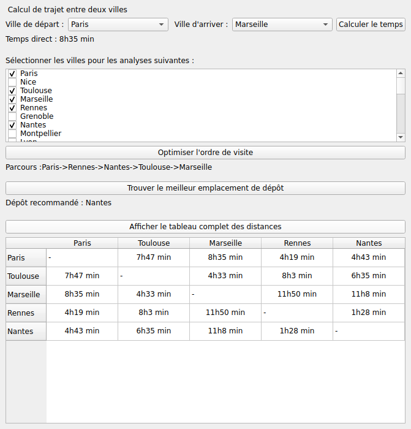

# Temps de route entre villes | SAÉ 2.02

Application Qt 6 en C++ qui calcule les temps de trajet minimaux entre des villes françaises, propose un ordre de visite pour une sélection de villes et désigne la meilleure ville de dépôt. SAÉ 2.02 « Exploration algorithmique d'un problème » du BUT Informatique (IUT d'Aix-Marseille, site d'Arles).

**Auteur :** Djawad TOURE ISSAHOU



## Fonctionnement

1. `chargerVilles()` lit `data/villes.csv` et construit la liste des villes.
2. `chargerTemps()` lit `data/temps.csv` (triplets `ville_i, ville_j, minutes`) et remplit la matrice des temps.
3. `plusCourtsChemins()` applique l'algorithme de **Floyd-Warshall** : plus courts chemins pour toutes les paires de villes, en O(n³).
4. `meilleurOrdre()` construit un ordre de visite avec l'heuristique du **plus proche voisin**, en s'appuyant sur les distances calculées par Floyd-Warshall.
5. `meilleurDepot()` choisit la ville centrale qui minimise la somme des trajets vers les villes choisies.

## Structure

| Fichier | Rôle |
| --- | --- |
| `ville.h` / `ville.cpp` | Classe `Ville` |
| `fonctions.h` / `fonctions.cpp` | Chargement des données et algorithmes |
| `mainwindow.h` / `mainwindow.cpp` | Interface Qt |
| `data/` | Villes et temps de trajet au format CSV |

## Correctif après le rendu

`temps.csv` identifie les villes par leur `city_id`, alors que l'interface utilise leur position dans `villes.csv`. Les temps affichés correspondaient donc à d'autres villes (Toulouse-Rennes en 2h). `chargerTemps()` convertit maintenant chaque `city_id` en position avant de remplir la matrice.

## Limites connues

- Le plus proche voisin donne un ordre rapide à calculer mais pas forcément optimal : une recherche exhaustive ou une amélioration 2-opt réduirait le temps total.
- La matrice des temps est de taille fixe (100 x 100).

## Compiler et lancer

Prérequis : Qt 6 (qmake) et un compilateur C++17. Le programme lit `data/` relativement au dossier courant : lancez-le depuis la racine du dépôt.

```bash
mkdir build && cd build
qmake6 ../TempsDeRoute.pro
make
cd .. && ./build/TempsDeRoute
```

